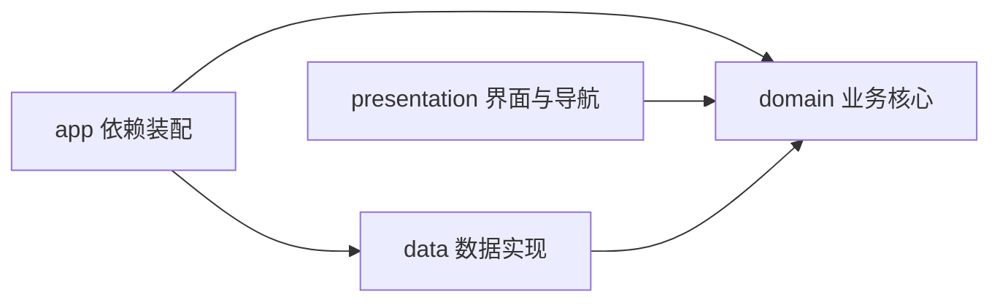

# Android 架构

## 目标

项目采用轻量分层架构，在保留 Java 17 与原生 Android View 的前提下隔离界面、业务契约和数据实现。当前规模不引入额外框架；后续接入网络、数据库或依赖注入框架时，可以逐层替换而不重写页面。

## 依赖方向



- domain：模型、校验规则和仓库接口。不得依赖 Android、app、data 或 presentation。
- data：仓库的具体实现和本地安全工具。可以依赖 Android 与 domain，不得依赖界面。
- presentation：Activity、页面、导航和 View 工具。只面向 domain 接口，不直接引用 data 实现。
- app：唯一的依赖装配入口。FoodtimeApplication 创建 LocalRepository，并通过 RepositoryProvider 向界面暴露仓库接口。

Gradle 任务 `verifyArchitecture` 会检查以上边界；它已经挂接到 `preBuild` 和 `check`，CI 也会显式执行。

## 目录

```text
cn.edu.bjtu.foodtime
├── app/                    # 应用启动与依赖装配
├── data/local/             # SharedPreferences/JSON 本地实现
├── domain/model/           # 业务模型
├── domain/repository/      # 数据访问契约与 Provider 端口
├── domain/validation/      # 可独立测试的业务校验
└── presentation/           # Activity、Screen、设计系统和 View 工具
```

## 扩展方式

新增功能时优先按以下顺序：

1. 在 domain 中补充模型、规则或仓库契约，并先写单元测试。
2. 在 data 中实现接口；网络实现建议新增 data/remote，并由 data/repository 组合远端与缓存。
3. 在 presentation 中新增或调整页面，只调用 domain 接口。
4. 需要更换实现时，只修改 app/FoodtimeApplication 的装配代码。

当某个功能明显膨胀时，可在 presentation 下再按 feature 分包，但不要把数据读取逻辑放回 Screen 或 Activity。
